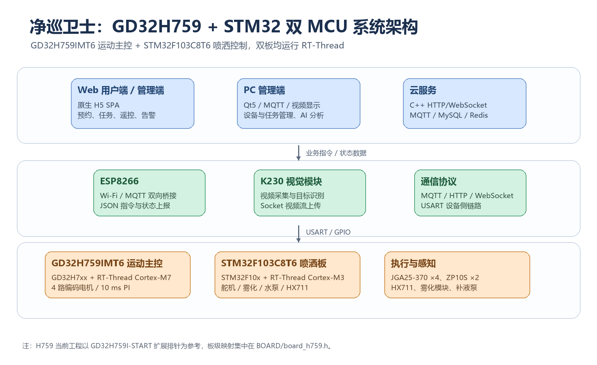
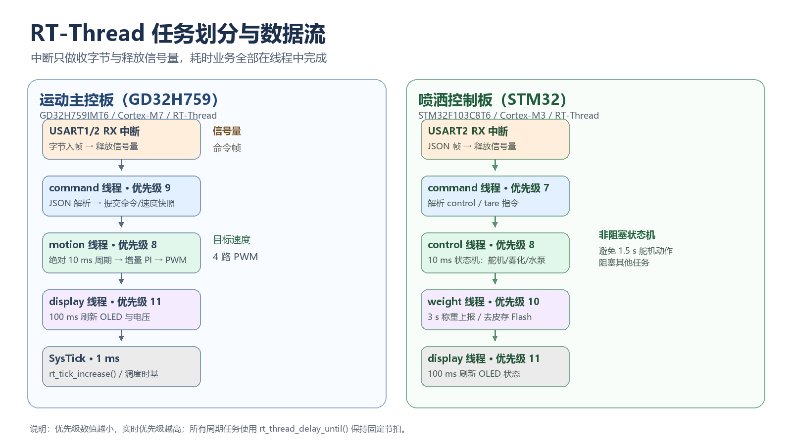

# 净巡卫士 · GD32H759 + STM32F103 双板 RT-Thread 工程

“净巡卫士”是一套面向教室、楼道、公共座椅等中小型公共区域的智能消杀移动装置。项目采用 **GD32H759IMT6 运动主控 + STM32F103C8T6 喷洒控制 + RT-Thread 4.1.1** 的双 MCU 架构，实现四轮差速移动、机械臂雾化喷洒、HX711 余量监测、远程遥控、预约消杀、状态上报和视频回传。

## 项目结构

```text
.
├─ docs/
│  ├─ submission-document.docx
│  ├─ submission-document.pdf
│  ├─ submission-copy.md
│  ├─ CODE_STYLE.md
│  ├─ HARDWARE.md
│  ├─ PROTOCOL.md
│  ├─ REGISTRATION_CORRECTION.md
│  ├─ GD32H759I-START_User_Guide.pdf
│  └─ assets/
├─ firmware/
│  ├─ gd32h759-main/             # GD32H759IMT6 运动主控 + RT-Thread Cortex-M7
│  └─ stm32f103-spray/           # STM32F103C8T6 喷洒控制 + RT-Thread Cortex-M3
├─ scripts/
│  ├─ build-keil.ps1
│  ├─ check_repo.py
│  └─ format-code.ps1
├─ .clang-format
├─ .gitattributes
├─ .gitignore
├─ CHANGELOG.md
├─ THIRD_PARTY_NOTICES.md
└─ README.md
```

## 系统架构



- **应用层**：Web 用户端/管理端、Qt5 PC 管理端、C++ 云服务（HTTP/WebSocket、MQTT、MySQL/Redis）。
- **传输层**：ESP8266 Wi-Fi/MQTT 桥接，K230 Socket 视频链路。
- **执行层**：GD32H759IMT6 运动主控、STM32F103C8T6 喷洒控制、JGA25-370 编码电机、ZP10S 总线舵机、HX711、雾化模块和补液泵。

## GD32H759 主控

- MCU：`GD32H759IMT6`，Cortex-M7。
- 固件库：GigaDevice `GD32H7xx` 标准外设库。
- RT-Thread：4.1.1，Cortex-M7 移植层。
- 系统时钟：600 MHz。
- PWM：TIMER0 四通道，10 kHz（TIMER0 时钟 300 MHz，周期 29999）。
- 编码器：TIMER1/2/3/4 正交解码。
- 串口：USART0 调试，USART1 ESP8266，USART2 蓝牙/备用。
- 板级映射：以官方 `GD32H759I-START` 扩展排针为参考，集中在 `firmware/gd32h759-main/BOARD/board_h759.h`。自定义 H759 板只需修改该文件的端口、引脚和 AF 编号。

> 注意：H759 的定时器 AF 编号和 PWM 通道映射必须与实际开发板原理图核对；当前工程已通过编译，但上电前必须按第 6.2 节完成硬件复测。

## RT-Thread 任务模型



### GD32H759 运动主控

| 线程/中断 | 优先级 | 周期 | 职责 |
|---|---:|---|---|
| `motion` | 8 | 10 ms | 四路编码器采样、增量 PI、PWM 输出 |
| `command` | 9 | 事件驱动 | JSON 解析、命令与速度快照提交 |
| `display` | 11 | 100 ms | OLED、电压与状态显示 |
| USART1/2 RX | 中断 | 字节到达 | 组帧、释放信号量 |

### STM32F103 喷洒控制

| 线程/中断 | 优先级 | 周期 | 职责 |
|---|---:|---|---|
| `command` | 7 | 事件驱动 | 解析 `control` / `tare` |
| `control` | 8 | 10 ms | 舵机、雾化、水泵非阻塞状态机 |
| `weight` | 10 | 3 s / 去皮请求 | HX711 称重、Flash 保存、重量上报 |
| `display` | 11 | 100 ms | OLED 状态显示 |

## 构建

使用 Keil MDK 打开：

- `firmware/gd32h759-main/MDK-ARM/GD32H759_RTThread.uvprojx`
- `firmware/stm32f103-spray/SPRAY_RTThread.uvprojx`

编译结果：

| 工程 | 结果 | Code | RO-data | RW-data | ZI-data |
|---|---|---|---:|---:|---:|---:|
| GD32H759 主控 | **0 errors / 0 warnings** | 43,534 B | 7,090 B | 104 B | 72,032 B |
| STM32F103 喷洒 | 0 errors / 1 vendor-port warning | 13,724 B | 1,912 B | 264 B | 10,616 B |

命令行构建：

```powershell
pwsh scripts/build-keil.ps1
```

## 通信协议

运动控制：

```json
{"command":"forward"}
{"command":"backward"}
{"command":"left"}
{"command":"right"}
{"command":"stop"}
{"command":"forward","speed":2000}
{"speed":20}
```

喷洒控制：

```json
{"control":1}
{"control":0}
{"tare":1}
{"weight":1234}
```

MQTT 主题：`spray/weight`、`spray/control`、`device/wdlmj/control`。

## 文档

- 投稿文档：[docs/submission-document.docx](docs/submission-document.docx)
- PDF：[docs/submission-document.pdf](docs/submission-document.pdf)
- 网站短文案：[docs/submission-copy.md](docs/submission-copy.md)
- 硬件与引脚：[docs/HARDWARE.md](docs/HARDWARE.md)
- 通信协议：[docs/PROTOCOL.md](docs/PROTOCOL.md)
- 平台说明：[docs/REGISTRATION_CORRECTION.md](docs/REGISTRATION_CORRECTION.md)
- H759I-START 用户指南：[docs/GD32H759I-START_User_Guide.pdf](docs/GD32H759I-START_User_Guide.pdf)

## 当前状态

- GD32H759 主控工程：已迁移到 GD32H7xx + RT-Thread Cortex-M7，编译通过。
- STM32F103 喷洒工程：编译通过。
- 外设引脚、MQTT 主题和 JSON 协议保持兼容。
- H759 实机时序、PWM/编码器 AF 映射和电机参数需要按实际板卡完成上电复测。

## 许可证

RT-Thread 使用 Apache-2.0；GD32/STM32/WHEELTEC 组件的版权和许可见 [THIRD_PARTY_NOTICES.md](THIRD_PARTY_NOTICES.md)。项目自有代码的许可证尚未由作者确定，公开分发前请补充。
