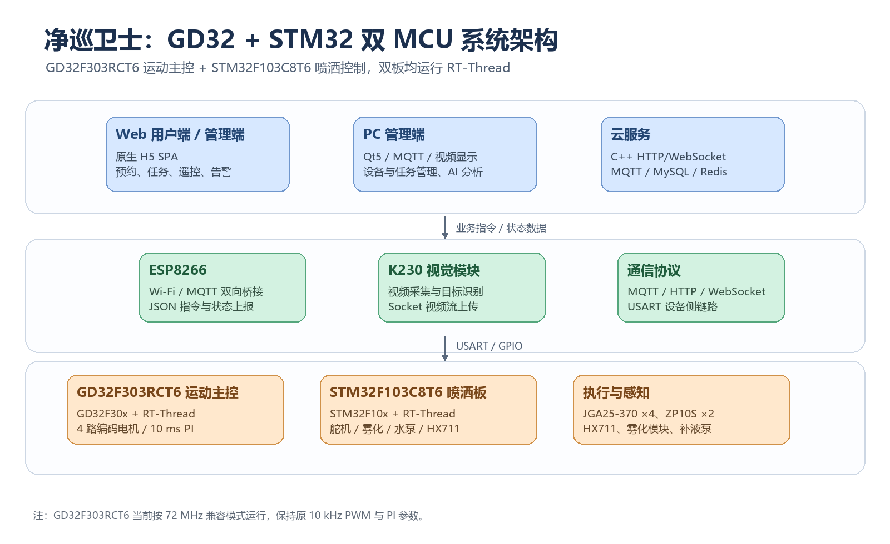
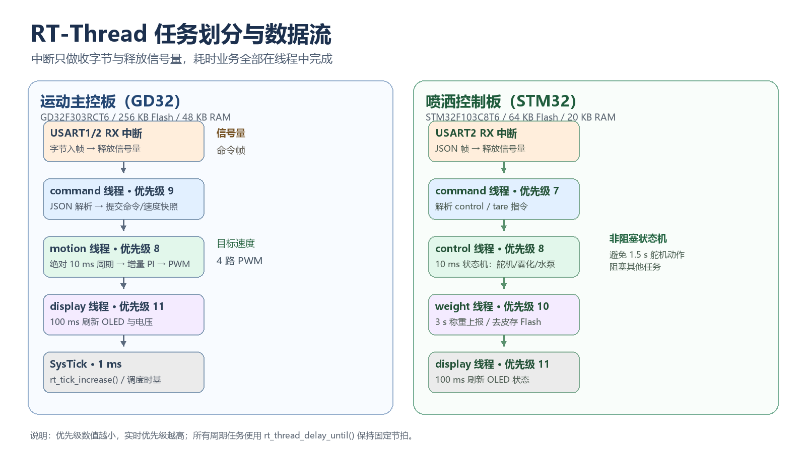

# 净巡卫士 · GD32F303 + STM32F103 双板 RT-Thread 工程


“净巡卫士”是一套面向教室、楼道、公共座椅等中小型公共区域的智能消杀移动装置。项目采用 **GD32F303RCT6 运动主控 + STM32F103C8T6 喷洒控制 + RT-Thread 4.1.1** 的双 MCU 架构，实现四轮差速移动、机械臂雾化喷洒、HX711 余量监测、远程遥控、预约消杀、状态上报和视频回传。

## 项目结构

```text
.
├─ docs/
│  ├─ submission-document.docx   # 投稿文档
│  ├─ submission-document.pdf    # PDF 版本
│  ├─ submission-copy.md         # 网站表单文案
│  ├─ CODE_STYLE.md
│  └─ assets/                    # 架构图与任务图
├─ firmware/
│  ├─ gd32f303-main/             # GD32F303RCT6 运动主控
│  └─ stm32f103-spray/           # STM32F103C8T6 喷洒控制
├─ scripts/
│  ├─ build-keil.ps1
│  ├─ check_repo.py
│  └─ format-code.ps1
├─ .clang-format
├─ .gitattributes
├─ .gitignore
├─ CHANGELOG.md
├─ THIRD_PARTY_NOTICES.md
└─ README.md
```

## 系统架构



- **应用层**：Web 用户端/管理端、Qt5 PC 管理端、C++ 云服务（HTTP/WebSocket、MQTT、MySQL/Redis）。
- **传输层**：ESP8266 Wi-Fi/MQTT 桥接，K230 Socket 视频链路。
- **执行层**：GD32F303RCT6 运动主控、STM32F103C8T6 喷洒控制板、JGA25-370 编码电机、ZP10S 总线舵机、HX711、雾化模块和补液泵。

## RT-Thread 任务模型



### GD32F303 运动主控

| 线程/中断 | 优先级 | 周期 | 职责 |
|---|---:|---|---|
| `motion` | 8 | 10 ms | 四路编码器采样、增量 PI、PWM 输出 |
| `command` | 9 | 事件驱动 | JSON 解析、命令与速度快照提交 |
| `display` | 11 | 100 ms | OLED、电压与状态显示 |
| USART RX | 中断 | 字节到达 | 组帧、释放信号量 |

### STM32F103 喷洒控制

| 线程/中断 | 优先级 | 周期 | 职责 |
|---|---:|---|---|
| `command` | 7 | 事件驱动 | 解析 `control` / `tare` |
| `control` | 8 | 10 ms | 舵机、雾化、水泵非阻塞状态机 |
| `weight` | 10 | 3 s / 去皮请求 | HX711 称重、Flash 保存、重量上报 |
| `display` | 11 | 100 ms | OLED 状态显示 |

## GD32 迁移说明

- 主控 MCU：`GD32F303RCT6`，与 `STM32F103RCT6` 引脚兼容。
- 固件库：`GD32F30x` standard peripheral library。
- RT-Thread 端口：Cortex-M4。
- 当前主频：72 MHz 兼容模式，保持原 10 kHz PWM 和 PI 参数。
- 映射：`TIM2/3/4/5/8 → TIMER1/2/3/4/7`，`USART1/2/3 → USART0/1/2`，`ADC1 → ADC0`。
- 外设引脚、JSON 协议和 MQTT 主题保持不变。

## 构建

### Keil MDK

使用 Keil MDK 打开：

- `firmware/gd32f303-main/USER/GD32F303_RTThread.uvprojx`
- `firmware/stm32f103-spray/SPRAY_RTThread.uvprojx`

编译结果：

| 工程 | 结果 |
|---|---|
| GD32F303 主控 | 0 errors / 0 warnings |
| STM32F103 喷洒 | 0 errors / 1 vendor-port warning |

### 命令行构建

```powershell
pwsh scripts/build-keil.ps1
```

脚本会自动查找 `UV4.exe`，并将构建日志写入 `build-logs/`。

## 通信协议

运动控制：

```json
{"command":"forward"}
{"command":"backward"}
{"command":"left"}
{"command":"right"}
{"command":"stop"}
{"command":"forward","speed":2000}
{"speed":20}
```

喷洒控制：

```json
{"control":1}
{"control":0}
{"tare":1}
{"weight":1234}
```

MQTT 主题：`spray/weight`、`spray/control`、`device/wdlmj/control`。

## 文档

- 投稿文档：[docs/submission-document.docx](docs/submission-document.docx)
- PDF：[docs/submission-document.pdf](docs/submission-document.pdf)
- 网站短文案：[docs/submission-copy.md](docs/submission-copy.md)
- 硬件与引脚：[docs/HARDWARE.md](docs/HARDWARE.md)
- 通信协议：[docs/PROTOCOL.md](docs/PROTOCOL.md)
- 代码格式：[docs/CODE_STYLE.md](docs/CODE_STYLE.md)

## 当前状态

- GD32F303 主控工程：编译通过。
- STM32F103 喷洒工程：编译通过。
- 外设引脚、MQTT 主题和 JSON 协议保持兼容。
- 迁移后的整机时序仍建议按投稿文档第 6.2 节进行上电复测。

## 许可证

RT-Thread 使用 Apache-2.0；GD32/STM32/WHEELTEC 组件的版权和许可见 [THIRD_PARTY_NOTICES.md](THIRD_PARTY_NOTICES.md)。项目自有代码的许可证尚未由作者确定，公开分发前请补充。


## 上传到 GitHub

首次推送时，将 `<your-name>` 替换为你的 GitHub 用户名：

```bash
git remote add origin https://github.com/<your-name>/JingXun-WeiShi-GD32-RTThread.git
git push -u origin main
```

仓库已包含 `main` 分支的初始提交；如果 GitHub 仓库已创建并带有 README，请先执行 `git pull --rebase origin main` 再推送。
